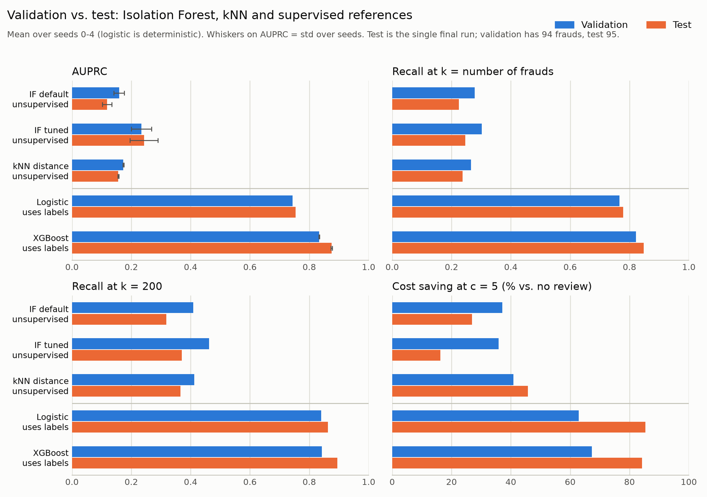

# STOR 565: Isolation Forest for Credit Card Fraud Detection

STOR 565 group project: We study **Isolation Forest (IF)** as an unsupervised anomaly
detector on the credit card fraud dataset and compare it with kNN distance
(unsupervised), logistic regression and XGBoost (supervised references).
PCA reconstruction was dropped because V1–V28 are already PCA-transformed.

Because fraud is extremely rare (about 0.17% of transactions), accuracy is misleading
(predicting "all normal" already gives about 99.8%). We evaluate with **AUPRC** and **recall@k** (k = 50, k = number of frauds, and k = 200).

## Team

| Role | Member | Main responsibility |
|---|---|---|
| A: Method lead | TODO | IF math, 2D demo, sensitivity analysis |
| B: Data lead | Thu Nguyen | Data loading, split, EDA, data documentation |
| C: Evaluation & IF lead | Yuqi Peng | Evaluation function, IF runs, scaling experiment, final test run |
| D: Baselines lead | Zihan Zhao | kNN distance, logistic regression, XGBoost, failure and fraud-amount analysis |
| E: Integration lead | TODO | Repo, README, AI-use log, slides, report |

## Repository structure

```
.
├── README.md
├── requirements.txt
├── AI_USE_LOG.md                # E: running AI-use log (team appendix)
├── AI_USE_NOTES_D.md            # D: AI-use notes for the baselines
├── BASELINES_NOTES.md           # D: baseline findings (validation)
├── BASELINES_HANDOFF.md         # D: frozen configs and policies for the final test run
├── src/
│   ├── Data565.ipynb            # B: data preparation, stratified random split, EDA
│   ├── make_random_split.py     # Kaggle download -> dedup -> random 60/20/20 split
│   ├── data_loader.py           # Shared data loader (load_test is for final_test.py only)
│   ├── check_split.py           # E: sanity check + fingerprints of the split files
│   ├── eval_utils.py            # C: evaluation metrics (AUPRC, recall@k, PR curves)
│   ├── run_if.py                # C: IF default vs. tuned (psi=4096) vs. psi=10000
│   ├── tune_if.py               # C: IF grid over psi x n_estimators (validation only)
│   ├── scaling_experiment.py    # C: scaling experiment (IF vs kNN)
│   ├── baseline_utils.py        # D: shared kNN / logistic / XGBoost estimators, helpers
│   ├── run_knn.py               # D: kNN distance tuning (k, Time)
│   ├── run_logistic.py          # D: logistic regression tuning (C, class weight)
│   ├── run_xgboost.py           # D: XGBoost tuning (scale_pos_weight)
│   ├── compare_baselines.py     # D: refit selected models, comparison table, failure cases
│   ├── fraud_amount_analysis.py # D: review budgets and cost policies (raw Amount)
│   ├── final_test.py            # C: the single final test-set run (needs --run-final-test)
│   ├── make_summary.py          # C: validation + test results in one table and figure
│   ├── toy_1d.py                # A: 1-2-3-4-100 toy example (exact E[h], score)
│   └── demo_2d.py               # A: 2D isolation-tree demo figures
├── results/                     # tables (csv); final_test_*.csv and summary_val_test.csv are final
├── figures/                     # figures for slides and report
├── tests/                       # pytest unit tests (synthetic data, no real data needed)
└── test.py                      # quick row/fraud counts of the three split files
```

## Setup

```bash
git clone https://github.com/yuqisme/STOR-565-final-project.git
cd STOR-565-final-project
python -m venv .venv
source .venv/bin/activate        # Windows: .venv\Scripts\activate
pip install -r requirements.txt
python -m pytest -q              # unit tests, no real data needed
```

## Data

We use the Credit Card Fraud Detection dataset provided by the Machine Learning Group at Université Libre de Bruxelles (ULB).

- **Source:** https://www.kaggle.com/datasets/mlg-ulb/creditcardfraud
- **Access date:** November 5, 2026
- **License:** Open Database License (ODbL) — confirm against the Kaggle dataset page.
- **Dataset size:** 284,807 transactions, including 492 fraudulent transactions (0.1727%).
- **Features:** `Time`, `V1`–`V28` (PCA-transformed and anonymized), and `Amount`.
- **Target:** `Class` (0 = legitimate, 1 = fraud).
- **Split:** Deduplicated stratified random 60/20/20 split with random seed 0. Exact duplicate rows are removed before splitting.
- **Limitations:** The dataset covers only two days in September 2013. PCA anonymization limits feature interpretability, and the small number of fraudulent transactions makes evaluation challenging.
- **Data preparation:** The dataset is downloaded automatically from Kaggle.
Run:
```bash
python src/make_random_split.py
```

The dataset is not committed to GitHub. It can be downloaded from Kaggle or accessed through the shared Google Drive folder.
If you use the Drive files, put `train.csv`, `validation.csv` and `test.csv` in `data/random_split/`.

Either way, check the split:

```bash
python src/check_split.py
```

It should report 170,235 / 56,745 / 56,746 rows (284 / 94 / 95 frauds). The Drive files
should also show "matches shared split" for all three SHA-256 fingerprints.
Regenerating the split with `make_random_split.py` from the Kaggle file (Version 3) gives
byte-identical files with Python 3.13, numpy 2.5.3, pandas 3.0.5 (checked 2026-11-09 and
2026-11-12). With other library versions the CSV bytes can differ while the values are the
same: the baselines were tuned on files whose fingerprints differ from the Drive copy (see
`data_sha256` in `results/baselines_selected.json`), yet IF, kNN and logistic regression
reproduce exactly from the Drive files. So a fingerprint mismatch alone does not mean a
different split; the row and fraud counts plus the reproduced results do.

## Conventions (everyone follows these)

1. **Score direction:** higher score = more anomalous. Labels: `1` = fraud, `0` = normal.
   For IF use `-model.score_samples(X)` since sklearn's value is higher = more normal.
2. **Split**: Deduplicated stratified random 60/20/20 split with seed 0, generated by `src/make_random_split.py`.
   All experiments use the same fixed split.
3. **Test set:** it is used only in the single final evaluation (`final_test.py`), run by C once
   on 11/11 (done; results frozen, the script refuses to rerun). Never fit, tune, score or
   evaluate on it anywhere else. The only other use is
   integrity checks (row count, fraud count, SHA-256 fingerprint: `check_split.py`, `test.py`).
   All tuning uses the validation set.
4. **Metrics:** call `eval_utils.evaluate(y_true, scores)` so all results are comparable.

## How to reproduce results

Run from the repository root.

**Reproducibility check (2026-11-12, E):** every validation script below was re-run in order
from a clean checkout of `main` (commit `cc1c3ef`) on the Drive split (Linux x86-64,
Python 3.13, numpy 2.5.3, pandas 3.0.5, scikit-learn 1.9.1), and the outputs were compared
with the committed `results/*.csv`:

- **Reproduced exactly** (differences ≤ 1e-8, i.e. floating-point rounding): IF (`run_if.py`,
  `tune_if.py`, `scaling_experiment.py`), kNN, logistic regression, the 1D toy example, and every
  non-XGBoost row of `compare_baselines.py`. The committed result files were left unchanged.
- **XGBoost differs slightly across machines:** validation AUPRC differs by up to 0.004 from the
  committed values (e.g. 0.8358 vs. 0.8335 for seed 0), with the same selected configuration
  and the same ranking of methods. This persists with the committed XGBoost version (2.1.4).
  Within one machine XGBoost is fully deterministic (identical across repeated runs and thread
  counts), so the difference is most likely floating-point behaviour across CPU platforms; the
  committed baseline results were produced on macOS (see `results/baselines_selected.json`).
  XGBoost-derived numbers (cost policies, failure counts by model, summary table) shift
  accordingly; conclusions do not change.
- `final_test.py` was **not** re-run (test set is used once; results frozen on 2026-11-11).
  `make_summary.py` runs on the committed test results.

```bash
python src/make_random_split.py   # one-time (or use the Drive files): data/random_split/
python src/check_split.py         # confirm the split
python src/run_if.py              # IF default vs. tuned (psi=4096) vs. psi=10000, validation
python src/scaling_experiment.py  # scaling experiment (IF default/tuned vs kNN), validation, ~5 min
python src/tune_if.py             # IF grid psi x n_estimators, validation, ~2.5 min
python src/run_knn.py             # D: kNN tuning, writes results/knn_selected.json
python src/run_logistic.py        # D: logistic tuning, writes results/logistic_selected.json
python src/run_xgboost.py         # D: XGBoost tuning, writes results/xgboost_selected.json
python src/compare_baselines.py   # D: needs the three selected-config files and tune_if.py output
python src/fraud_amount_analysis.py  # D: run after compare_baselines.py (uses its score cache)
python src/toy_1d.py              # slides: 1-2-3-4-100 toy example, a few seconds
python src/demo_2d.py             # slides: 2D isolation demo figures, a few seconds
```

Final test run (C only, once; refuses to rerun; primary review cost c = 5). Already done
on 2026-11-11; do not run it again:

```bash
python src/final_test.py --run-final-test
python src/make_summary.py        # validation + test in one table: results/summary_val_test.csv
```

Outputs go to `results/` and `figures/`. The selected configuration JSON files are
the source for comparison refits. kNN uses a label-free, seeded 20,000-row training
reference sample; its scaler fits the entire training split, before sampling.
Random models report means and sample standard deviations over seeds 0–4;
logistic uses deterministic LBFGS with seed 0. Comparison columns without a suffix,
PR plots, failures and monetary policies use the predeclared seed 0, while
`*_mean`/`*_std` columns summarize independent seed runs, not an ensemble.

See `BASELINES_NOTES.md` for findings and `BASELINES_HANDOFF.md` for configurations,
score direction, raw-Amount accounting and frozen validation policies for C's final
test evaluation. Cost curves are validation-optimized and therefore optimistic.
The local `.baseline_cache/` is ignored; rerun comparison to regenerate it.

## Results

Mean ± sample std over seeds 0-4; no ± means deterministic (logistic) or negligible. Validation
has 94 frauds and test has 95 (random AUPRC = 0.0017 in both), so `R@n_pos` means k = 94 on
validation and k = 95 on test. Sources: `results/baselines_compare_val.csv`,
`results/final_test_metrics.csv`; the full table with every metric and std is
`results/summary_val_test.csv`. "c=5 saving" is the % lower cost than not reviewing at all
(missed fraud amount + 5 per reviewed transaction). On validation it is the optimum of each
model, so it is optimistic. On test the validation-frozen thresholds are applied unchanged.
"IF tuned" (200 trees, psi = 4096) is the best mean validation AUPRC of
`results/if_tuning_val.csv`; AUPRC is flat within noise for psi from about 2048 to 50000.
Test numbers are final: nothing was tuned on them.

| Method | Labels | AUPRC val | AUPRC test | R@n_pos val | R@n_pos test | R@200 val | R@200 test | c=5 saving val | c=5 saving test |
|---|---|---|---|---|---|---|---|---|---|
| IF default (100 trees, psi=256) | no | 0.159 ± 0.018 | 0.118 ± 0.016 | 0.279 | 0.225 | 0.409 | 0.318 | 37.2% | 26.9% |
| IF tuned (200 trees, psi=4096) | no | 0.235 ± 0.034 | 0.243 ± 0.047 | 0.302 | 0.246 | 0.462 | 0.371 | 35.8% | 16.3% |
| kNN distance | no | 0.173 ± 0.002 | 0.156 ± 0.001 | 0.266 | 0.238 | 0.413 | 0.366 | 40.9% | 45.8% |
| Logistic regression | yes | 0.743 | 0.754 | 0.766 | 0.779 | 0.840 | 0.863 | 62.9% | 85.4% |
| XGBoost | yes | 0.834 ± 0.001 | 0.875 ± 0.002 | 0.821 | 0.848 | 0.843 | 0.895 | 67.3% | 84.2% |



With only 94-95 frauds per split, differences of a few hundredths in AUPRC are within noise;
the seed std is not a confidence interval. See `BASELINES_NOTES.md` for baseline settings.

## Timeline

| Date | Milestone | Status |
|---|---|---|
| 11/6 | Fixed split and evaluation function merged | done |
| 11/9 | First results table (IF + 3 baselines) and 2D demo figure | done |
| 11/10 | Tuning and scaling experiment done | done |
| 11/11 | Final test run, results frozen | done |
| 11/14 | Slide draft submitted (due 11/16) | |
| 11/23 | Presentation | |
| 12/5 | Report, code, README, and AI-use appendix due (11:59 p.m.) | |

## AI use

We keep a running log of what was delegated to AI, what we kept, and what we checked
(see `AI_USE_LOG.md`, maintained by E). Code written with AI assistance is read and
cross-checked by a teammate.

## References

- Liu, F. T., Ting, K. M., & Zhou, Z.-H. (2008). Isolation Forest. *IEEE ICDM*.
